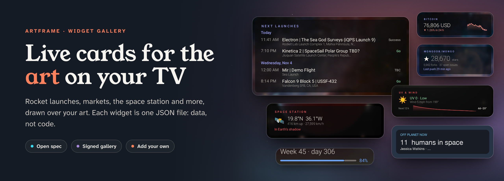
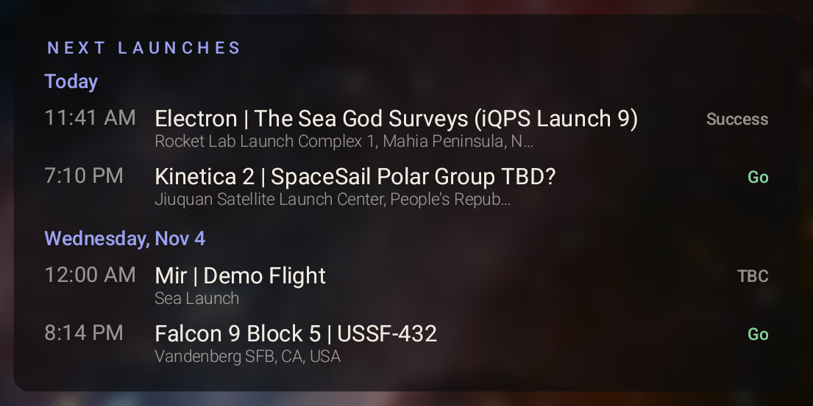
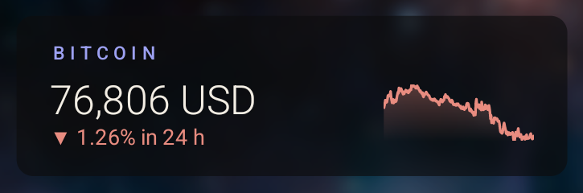
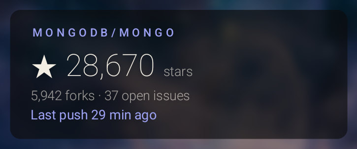
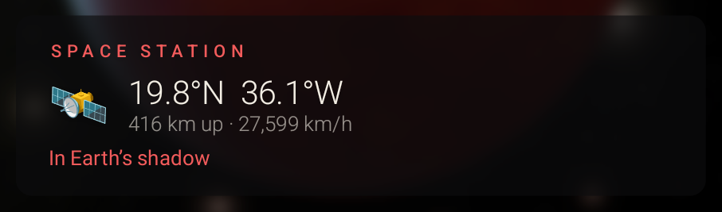
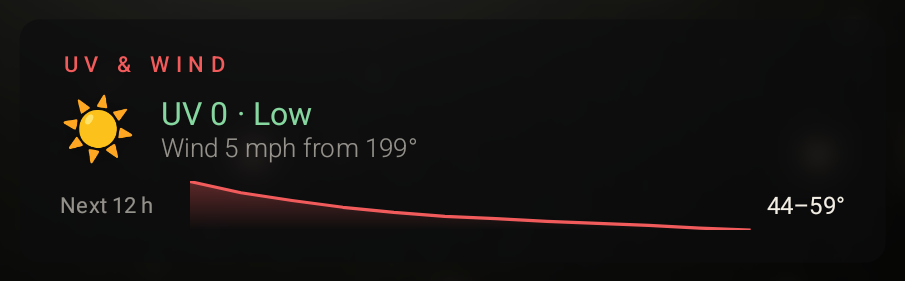
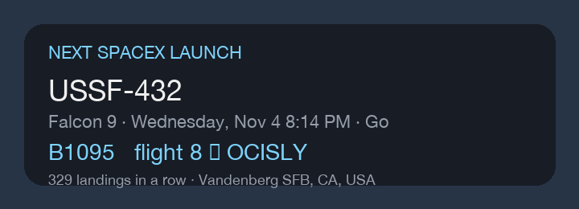
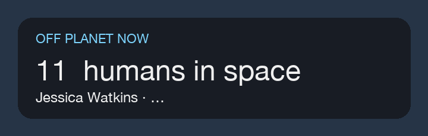
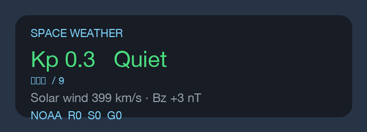
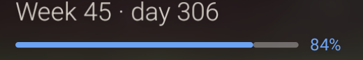

<p align="center">
  <a href="https://artframe.mlynn.dev">
    
  </a>
</p>

<p align="center">
  <a href="https://artframe.mlynn.dev/widgets/index.json"></a>
  <a href="https://github.com/mrlynn/artframe-widgets/actions/workflows/check.yml"></a>
  <a href="https://github.com/mrlynn/artframe-widgets/actions/workflows/publish.yml"></a>
  <a href="spec/SPEC.md"></a>
  <a href="#signing"></a>
  <a href="CONTRIBUTING.md"></a>
  <a href="https://github.com/mrlynn/artframe-widgets/stargazers"></a>
</p>

<p align="center">
  <a href="#the-gallery"><b>See the widgets</b></a> ·
  <a href="#write-your-own-in-one-file"><b>Write your own</b></a> ·
  <a href="spec/SPEC.md"><b>Read the spec</b></a> ·
  <a href="https://artframe.mlynn.dev"><b>Get ArtFrame</b></a>
</p>

---

Widgets for [ArtFrame](https://artframe.mlynn.dev)'s information HUD: the cards that sit
over the art on your TV. Each one is a single JSON file written to the
[widget spec](spec/SPEC.md). It's data, not code, so a widget can only show text, bars and
lines, and can only contact the sites it names.

> [!TIP]
> **Like having the next rocket launch hanging next to a Monet?** A ⭐ on this repo is how
> other people find the gallery, and how we know which widgets to build next.
> [Star it here.](https://github.com/mrlynn/artframe-widgets/stargazers)

## The gallery

Every widget below is live in **ArtFrameRemote › Screen › Cards › Browse Gallery…**, and
none needs an account or an API key.

<table>
  <tr>
    <td width="50%" valign="top">
      <a href="widgets/artframe.launches"></a><br>
      <b>Rocket launches</b>: the next launches anywhere in the world.<br>
      <sub><code>artframe.launches</code> · large · ll.thespacedevs.com</sub>
    </td>
    <td width="50%" valign="top">
      <a href="widgets/artframe.quote"></a><br>
      <b>Quote of the day</b>: a daily quotation.<br>
      <sub><code>artframe.quote</code> · wide · zenquotes.io</sub>
    </td>
  </tr>
  <tr>
    <td valign="top">
      <a href="widgets/artframe.crypto"></a><br>
      <b>Crypto price</b>: a coin's price with its last 24 hours as a sparkline.<br>
      <sub><code>artframe.crypto</code> · small · api.coingecko.com</sub>
    </td>
    <td valign="top">
      <a href="widgets/artframe.github"></a><br>
      <b>GitHub repository</b>: stars, forks and open issues for any repo.<br>
      <sub><code>artframe.github</code> · small · api.github.com</sub>
    </td>
  </tr>
  <tr>
    <td valign="top">
      <a href="widgets/artframe.iss"></a><br>
      <b>Space station</b>: where the ISS is right now.<br>
      <sub><code>artframe.iss</code> · small · api.wheretheiss.at</sub>
    </td>
    <td valign="top">
      <a href="widgets/artframe.uv-wind"></a><br>
      <b>UV and wind</b>: UV index, wind and the next 12 hours of temperature.<br>
      <sub><code>artframe.uv-wind</code> · small · api.open-meteo.com</sub>
    </td>
  </tr>
  <tr>
    <td valign="top">
      <a href="widgets/mlynn.spacex-booster"></a><br>
      <b>Next SpaceX launch</b>: the booster flying it, how often it's flown, where it lands.<br>
      <sub><code>mlynn.spacex-booster</code> · small · ll.thespacedevs.com</sub>
    </td>
    <td valign="top">
      <a href="widgets/mlynn.people-in-space"></a><br>
      <b>People in space</b>: how many humans are off the planet, and who.<br>
      <sub><code>mlynn.people-in-space</code> · small · ll.thespacedevs.com</sub>
    </td>
  </tr>
  <tr>
    <td valign="top">
      <a href="widgets/mlynn.space-weather"></a><br>
      <b>Space weather</b>: Kp index, solar wind and NOAA storm scales.<br>
      <sub><code>mlynn.space-weather</code> · small · services.swpc.noaa.gov</sub>
    </td>
    <td valign="top">
      <a href="widgets/artframe.year-progress"></a><br>
      <b>Year progress</b>: week, day of the year and how much of it has gone.<br>
      <sub><code>artframe.year-progress</code> · small · contacts nothing</sub>
    </td>
  </tr>
</table>

**Got an idea for one?** [Open an issue](https://github.com/mrlynn/artframe-widgets/issues/new)
with the data source, or build it yourself. The next section shows how.

## Installing one

In ArtFrameRemote on your Mac, open **Screen › Cards**, click **Browse Gallery…**, find the
widget and add it. Before you turn it on, the app shows which sites the widget contacts and
what of yours it sends there. It goes to the TV with the next **Apply to TV**.

You can also download a widget's `widget.json` and use **Add Widget…**.

## Write your own in one file

A widget is a name, some settings, optional data sources and a layout. This is a complete
one, a countdown to a date you choose:

```json
{
  "spec": 1,
  "id": "yourname.countdown",
  "name": "Countdown",
  "description": "Days until a date you choose",
  "author": "Your Name",
  "version": "1.0.0",
  "size": "small",
  "title": "{{ settings.label }}",
  "settings": [
    { "key": "label", "label": "What's happening", "type": "text", "default": "Vacation" },
    { "key": "date",  "label": "Date (YYYY-MM-DD)", "type": "text", "default": "2026-12-24" }
  ],
  "layout": {
    "type": "row", "align": "baseline",
    "children": [
      { "type": "text", "text": "{{ settings.date | daysUntil | abs }}", "size": 58, "font": "thin" },
      { "type": "text", "text": "days to go", "before": 10, "size": 16, "color": "muted" }
    ]
  }
}
```

Add a `data` block to pull JSON from any public API and you have a live card. The
[spec](spec/SPEC.md) covers [data sources](spec/SPEC.md#data),
[expressions and filters](spec/SPEC.md#expressions), [layout](spec/SPEC.md#layout) and
[testing on your own TV](spec/SPEC.md#installing-and-testing). The
[examples](spec/examples) and the [built-ins](spec/built-in) are good starting points.

When it works on your TV, [send it in](CONTRIBUTING.md): one folder, one pull request, and
CI tells you within minutes whether the TV will load it.

## Why a widget can't hurt your TV

- **Data, not code.** No scripts. A widget can only arrange text, bars and lines.
- **It names its sites.** The TV refuses any host a widget didn't declare, and the Mac app
  shows you each one, and what goes to it, before you turn the widget on.
- **Checked by the TV's own parser.** CI runs the same code the TV does on every pull request.
- **A signed gallery.** The index is signed with Ed25519, and ArtFrameRemote rejects one
  that's been changed or served from anywhere else. Bad widgets can be revoked, and the app
  turns them off.

More in [SECURITY.md](SECURITY.md).

## What's here

| Folder | What it is |
| --- | --- |
| `widgets/<id>/` | One widget: `widget.json`, `screenshot.png` and an optional `README.md` |
| `spec/` | The widget spec, its JSON Schema and examples, copied from the app |
| `checker/` | The TV's own widget parser, run on a desktop JVM to check widgets |
| `tools/` | `build_index.py` checks every widget and writes the published index; `check_pr.py` holds pull requests to the ownership rules; `sync-from-app.sh` refreshes `spec/` and `checker/` from the app |
| `docs/readme/` | This page's banner: `banner.html` and `render.sh`, which renders it to `banner.png` |

Every pull request is checked by CI: the widget must load on the TV, and it must follow
the rules in [CONTRIBUTING.md](CONTRIBUTING.md). The check that guards merging
(`.github/workflows/policy.yml`) runs the base branch's tools against the pull request's
widgets, so a pull request can't change the rules it's held to. `owners.json` maps each
id prefix to the GitHub logins that own it.

## How a merged widget reaches people

1. On every push to `main`, `.github/workflows/publish.yml` checks the widgets, builds
   `dist/` and deploys it to GitHub Pages at `https://mrlynn.github.io/artframe-widgets/`.
2. The site rewrites `artframe.mlynn.dev/widgets/index.json`, `widget.schema.json` and
   `/widgets/<id>/…` to that copy, so the published index is current within minutes, with
   no manual sync.
3. ArtFrameRemote fetches the index when someone opens **Screen › Cards › Browse
   Gallery…**. It doesn't poll, and nothing installs itself: a person picks a widget (or an
   update, when the gallery has a newer `version`), and it goes to the TV with the next
   **Apply to TV**. The TV never reads the index.

## Building the index

Needs JDK 17 and Python 3; nothing else. The script finds JDK 17 itself (`JAVA_HOME`,
then `/usr/libexec/java_home -v 17` on macOS, then Homebrew's `openjdk@17`, then `java`
on `PATH`).

```bash
tools/build_index.py --check          # check every widget
tools/build_index.py                  # check, then write dist/ (unsigned, with a warning)
ARTFRAME_INDEX_SIGNING_KEY=~/.artframe-keys/index-signing-current.key tools/build_index.py
                                      # signed, as CI does it
python3 -m unittest discover -s tools # the index tools' own tests
```

`dist/` holds `index.json`, its signature `index.json.sig`, each widget at `<id>/<version>.widget.json`, its
screenshot, and `widget.schema.json`. You only need to build it locally to preview; CI
publishes it.

### index.json

```json
{
  "format": 2,
  "checkedWith": "d4c793d",
  "issuedAt": "2026-11-03T15:00:00Z",
  "expires": "2026-12-03T15:00:00Z",
  "revoked": [{"id": "someone.widget", "versions": "*", "reason": "…"}],
  "widgets": [{
    "id": "artframe.github", "name": "GitHub repository", "description": "…",
    "icon": "star", "size": "small", "author": "ArtFrame", "version": "1.0.0",
    "homepage": null, "spec": 1,
    "sites": ["api.github.com"], "choosesSite": false, "needsKey": false,
    "file": "artframe.github/1.0.0.widget.json", "sha256": "…", "bytes": 1583,
    "screenshot": "artframe.github/screenshot.png"
  }]
}
```

- `sites`: every host the widget can contact; the TV refuses any other.
- `choosesSite`: one of its sources contacts a site the person types into its settings.
- `needsKey`: it has a secret setting, such as an API key.
- `file` and `screenshot` are relative to the index. Check `sha256` after downloading.
- `checkedWith`: the app commit whose parser checked these widgets.
- `issuedAt`, `expires`: when it was built, and 30 days on. ArtFrameRemote still shows an
  expired index but won't install from it, and refuses one older than the last it saw.
- `revoked`: from `revoked.json`. ArtFrameRemote turns those widgets off on the TV (matched
  by id, so sideloaded copies too; `versions` is `"*"` or a list) and offers to remove them.
  A revoked version is also left out of `widgets`.

### Signing

`index.json.sig` is the base64 Ed25519 signature of `index.json`'s exact bytes.
ArtFrameRemote checks it against two public keys built into the app (current and backup)
and rejects an index that fails, so changing anything in it, or serving it from anywhere
but `artframe.mlynn.dev`, stops it being used. `publish.yml` signs with the
`ARTFRAME_INDEX_SIGNING_KEY` repository secret (the base64 private key) and fails rather
than publish unsigned. Locally the variable can be the key or a path to a file holding it.
If the current key is lost or leaks, sign with the backup key and ship an app with a new
backup.

---

<p align="center">
  <b>Made something nice for your wall?</b> <a href="CONTRIBUTING.md">Add it to the gallery</a>.<br>
  <b>Enjoying the ones here?</b> <a href="https://github.com/mrlynn/artframe-widgets/stargazers">Give the repo a ⭐</a> so more people find it.
</p>
